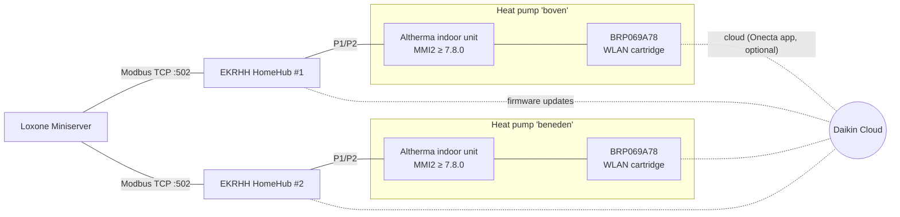

# Plan: native Daikin Altherma integration in Loxone

Goal: control and monitor both Daikin Altherma heat pumps ("boven" and "beneden")
**directly from the Loxone Miniserver**, and remove Home Assistant from the chain.

Status: **Phase 0, verifying compatibility.** Decisions marked ❓ are waiting on input
(see [Open questions](#open-questions)).

---

## 1. Why not the existing WLAN cartridges or the Onecta API?

- The installed **BRP069A78** WLAN cartridges (firmware 4.0.1) expose **no local API**.
  Only adapter metadata is available locally; all heat-pump data goes through the Daikin
  cloud. Evidence: [findings/2026-10-21-brp069a78-local-api.md](findings/2026-10-21-brp069a78-local-api.md).
- The **Onecta cloud API** (used by
  [jwillemsen/daikin_onecta](https://github.com/jwillemsen/daikin_onecta)) needs an OAuth2
  authorization-code flow with rotating refresh tokens over HTTPS. The Miniserver cannot
  run or persist that flow, so this route always needs software outside Loxone (HA, a
  LoxBerry plugin, or a custom bridge). It is also rate-limited to about 200 calls/day
  and depends on Daikin's cloud.

**So a native integration needs a local, standard interface on the heat pump. Daikin
offers that through Modbus.**

## 2. Options compared

| | A. Daikin HomeHub EKRHH (Modbus TCP) ⭐ | B. DCOM-LT/MB gateway (Modbus RTU) | C. Cloud bridge (Onecta API) |
|---|---|---|---|
| Native in Loxone | ✅ Miniserver Modbus TCP, no extra Loxone hardware | ✅ needs Loxone Modbus Extension (RS-485) | ❌ always needs a server outside Loxone |
| Local, no cloud | ✅ | ✅ | ❌ |
| Latency | seconds | seconds | minutes (polling budget) |
| Keeps Onecta app + WLAN cartridge | ✅ Daikin lists the unit's WLAN adapter as compatible for use case 3 | ❓ to verify | ✅ |
| Hardware per heat pump | 1× EKRHH, P1/P2 wiring + LAN | 1× DCOM-LT/MB, P1/P2 wiring + RS-485 | none |
| Loxone template available | ✅ Loxone Library "Daikin Heating & Cooling" | ✅ Loxone Library "Daikin DCOM gateways for Altherma" | – |
| Extra features | Smart Grid modes + power limits (PV self-consumption) | depends on DCOM register map | whatever the cloud exposes |
| Main constraint | unit model on compatibility list, MMI2 firmware ≥ 7.8.0 | cannot be combined with HomeHub | not native, rate limits |

**Recommendation: Option A, one Daikin HomeHub (EKRHH) per heat pump, connected to
the Miniserver over Modbus TCP.** It is Daikin's official local interface for third-party
home automation, Loxone already publishes a template for it, and it keeps the Onecta app
working. Option B is the fallback if a unit is not HomeHub-compatible. Option C is only
for the case where no hardware may be added.

## 3. Target architecture (Option A)

- Each HomeHub is wired to its indoor unit's **P1/P2** bus and to the LAN by cable.
- The Miniserver polls input registers (temperatures, status, power, errors) and writes
  holding registers (setpoints, on/off, modes, DHW, Smart Grid).
- Home Assistant is no longer involved.

Register map: [reference/ekrhh-modbus-registers.md](reference/ekrhh-modbus-registers.md).

## 4. Phases

### Phase 0: Verify compatibility (no cost) ← *we are here*

1. Identify **both** indoor units: model (e.g. `EHVX…`, `EHBH…`, `ETVH…`), outdoor unit
   model, and **Hydro SW / Micon ID**. Check them against the EKRHH compatibility table
   (Altherma 3 R / 3 R MT / 3 H MT / 3 H HT / 3 M).
2. Read the **MMI2 user-interface software version** on each unit (≥ 7.8.0 required).
   Update through the Onecta app if it is older.
3. Confirm that "boven" and "beneden" are two separate heat pumps (two indoor units),
   which means two HomeHubs.
4. Confirm the Miniserver model and Loxone Config version (Modbus TCP support), and check
   that HomeHubs can sit on the same network as the Miniserver (192.168.10.0/24).
5. Inventory what Loxone currently receives from or sends to Home Assistant for the Daikin
   units, so nothing is lost at cutover.

Exit criteria: both units confirmed compatible, so we go for Option A. Otherwise pick B or C per unit.

### Phase 1: Hardware

1. Buy 2× **EKRHH** Daikin HomeHub (with power supply).
2. An installer connects HomeHub **P1/P2 → indoor unit P1/P2** and the LAN cable.
   Mind the cable-length limits in the EKRHH guide §4.2.
3. Commission in the **ONECTA app** (≥ 3.21.1). Activate **Use case 3: Modbus**, select
   **TCP**, and note the unit id. Only one use case can be active per HomeHub.
4. Give each HomeHub a **DHCP reservation** (fixed IP) in the router.
5. Check that the WLAN cartridges and Onecta app still work.

### Phase 2: Verify Modbus from a laptop (before touching Loxone)

1. Add `tools/modbus_check.py` (pymodbus) to this repo. It reads all input and holding
   registers of a HomeHub and prints them decoded (Temp16, Pow16, Text16, special values).
2. Run it against both HomeHubs and save sanitized output under `docs/findings/`.
3. Mark which registers are unsupported (32767) or unavailable (32766) on these units.

### Phase 3: Loxone Config – Modbus devices

1. Per HomeHub: add a **Modbus Server** (Modbus TCP, IP, port 502, unit id).
2. Start from the Loxone Library template **"Daikin Heating & Cooling"** (EKRHH, use case 3).
   Compare it against the register map and extend it where needed. Keep our own exported
   template in `loxone/templates/` (versioned in this repo).
3. Sensors (FC 4, signed 16-bit, ÷100 for Temp16/Pow16): leaving/return water, DHW,
   outdoor, room temperature, power, flow, compressor/pump/defrost/3-way valve,
   error state, code and sub-code.
4. Actuators (FC 6): space heating on/off, room setpoint or LWT setpoint/offset, operation
   mode, quiet mode, DHW reheat on/off, DHW setpoint, DHW booster, Smart Grid mode,
   power limits.
5. Polling: 10–30 s for status/temperatures, slower (60 s+) for limits and static values.

### Phase 4: Loxone logic and visualization

Pick the control strategy per heat pump ❓:

- **4a. Loxone sets comfort, Daikin regulates (simplest):** Loxone writes room
  setpoint (reg 6/7) and on/off (reg 4). The Altherma keeps its own weather-dependent curve.
- **4b. Loxone as the thermostat:** Intelligent Room Controllers → Climate Controller
  heat demand → space heating on/off (reg 4) and/or LWT offset (reg 54). This only works
  if the unit control method `[C-07]` allows it.
- **DHW:** reheat on/off (reg 12) and setpoint (reg 10) from Loxone schedules/presence,
  booster (reg 13) on demand.
- **PV / energy (optional):** Smart Grid mode (reg 56) and power limits (reg 57/58)
  driven by Loxone energy management (e.g. *recommended on* during PV surplus).
- **Watchdog:** periodically re-write the desired state, because HomeHub writes are change
  based. Raise a Loxone notification on unit abnormality (reg 21–23) and on Modbus
  communication loss.
- **Visualization:** Loxone app tiles for both heat pumps, statistics for power (reg 51)
  and temperatures.
- Avoid conflicting controllers: disable Onecta/MMI schedules for functions Loxone takes over.

### Phase 5: Parallel run and cutover

1. Run Loxone (Modbus) alongside the existing HA path for a few days and compare values.
2. Switch the Loxone logic over to the Modbus objects and remove the HA virtual
   inputs/outputs.
3. Remove the Daikin Onecta integration from HA. Decommission HA if nothing else depends on it.

### Phase 6: Documentation

- Export the final Loxone Modbus templates to `loxone/templates/`.
- Wiring and commissioning notes with photos in `docs/`.
- A short "how to rebuild from scratch" guide.

## 5. Fallbacks

- **Option B, DCOM-LT/MB** (Modbus RTU) for a unit that is not HomeHub-compatible:
  needs a Loxone **Modbus Extension**. It cannot be combined with a HomeHub on the same
  unit. Compatibility with the WLAN cartridge still has to be verified.
- **Option C, cloud bridge:** a small always-on service (Docker) using the MIT-licensed
  [`daikin-onecta`](https://github.com/jwillemsen/daikin-onecta) library that pushes state
  to Loxone virtual inputs and accepts commands from virtual outputs. It is not native,
  but needs no hardware. An existing alternative is the LoxBerry plugin
  [WaermepumpeCloud](https://github.com/Markus-Ende/LoxBerry-Plugin-WaermepumpeCloud).

## 6. Risks

| Risk | Mitigation |
|---|---|
| A unit or its MMI firmware is not on the EKRHH list | Phase 0 check before buying, with Option B or C as fallback |
| Registers 59/61 not operational on Micon ID 20002203 | Don't depend on them; use reg 4 / setpoints instead |
| Control conflicts between Loxone, MMI schedules and Onecta | Single owner per function, documented in Phase 4 |
| HomeHub reboot or network loss | Loxone watchdog + periodic re-write + notification |
| Daikin changes the register map in a firmware update | Pin the guide revision in `docs/reference/`, re-verify after updates |

## Open questions

1. **Indoor and outdoor unit model numbers** for both heat pumps (type label), plus the
   **Hydro SW / Micon ID** and **MMI software version** (on the unit: *Menu → Information*).
   The *Diagnostiek downloaden* JSON from the HA device page probably contains these too.
2. Are "boven" and "beneden" **two separate heat pumps**?
3. **Miniserver**: model (Gen 1 / Gen 2 / Compact / Go) and Loxone Config version. Is a
   Modbus Extension already installed?
4. Which Daikin values and commands does Loxone use from HA today?
5. OK to add hardware (2× EKRHH) and have an installer do the P1/P2 wiring?
6. Is there a **PV system / energy meter** in Loxone (for Smart Grid / power-limit use)?
7. Which control strategy (4a or 4b) fits the current setup (floor heating, radiators,
   external thermostats)?
