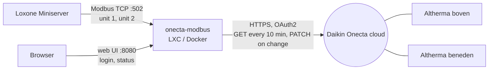

# Onecta → Modbus bridge

A small service that logs in to the Daikin Onecta cloud and offers your units to Loxone as a
**Modbus TCP server with the same register map as the Daikin HomeHub (EKRHH, use case 3)**.



Why this design:

- **Loxone talks plain Modbus TCP**, which the Miniserver supports natively. No PicoC, no
  virtual inputs or outputs, no tokens in Loxone.
- **HomeHub-compatible registers.** Templates written for a HomeHub work. If you ever install a
  real HomeHub, only the IP address in Loxone changes.
- **Extensions** for what Onecta adds: 0.5 °C setpoints, energy per day/month/year, cloud
  status and the remaining API budget.
- **Gentle on Daikin's 200 calls/day.** It polls every 10 min by day and every 30 min at
  night, and slows down when the budget runs low. Writes only cost a call when a value
  actually changes.

Why a bridge at all: the BRP069A78 cartridges have no local API, and a Miniserver can't send
the HTTP PATCH that Onecta requires for commands (see
[loxone-only-feasibility.md](loxone-only-feasibility.md)).

## Install

Any always-on Linux box on the LAN works. Requirements: Python 3.9+, about 40 MB RAM.

### Proxmox LXC (Debian 12/13) or any Debian/Ubuntu machine

```bash
apt-get install -y git
git clone https://github.com/JannickNijholt/daikin-altherma-loxone.git /opt/onecta-modbus/src
/opt/onecta-modbus/src/deploy/install.sh
```

To update: `git -C /opt/onecta-modbus/src pull && /opt/onecta-modbus/src/deploy/install.sh`.

The service runs as `onecta-modbus`, keeps its state in `/var/lib/onecta-modbus` (mode 0700)
and reads optional settings from `/etc/onecta-modbus.env`. Logs: `journalctl -u onecta-modbus -f`.

### Docker

```bash
docker compose up -d --build
```

State is kept in the `onecta-data` volume. Set `TZ` in `docker-compose.yml` so day/night
polling uses your local time.

## Connect Daikin (once)

1. Open `http://<bridge-ip>:8080/setup`. Use the bridge's **LAN IP**, not `localhost`:
   Daikin's firewall rejects login redirects to `localhost`/`127.0.0.1`.
2. At [developer.cloud.daikineurope.com](https://developer.cloud.daikineurope.com) create an
   app (sign in with the same email and login method as the Onecta app) with redirect URI
   `http://<bridge-ip>:8080/auth/callback`, exactly as shown on the setup page.
   An existing app (e.g. Home Assistant's, `https://my.home-assistant.io/redirect/oauth`) also
   works: enter that redirect URI instead and paste the browser address after logging in.
3. Enter the client ID and secret and click **Save**.
4. On the status page click **Log in with Daikin** and log in with the account that owns the
   heat pumps. Use a private window if your browser is logged in to another Daikin account.

The status page then lists the units with their **Modbus unit ID** (alphabetical by default,
changeable on the page and kept across restarts).

## Loxone

1. Loxone Config → **Device templates → Import template**:
   [`loxone/templates/MB_Onecta_Bridge.xml`](../loxone/templates/MB_Onecta_Bridge.xml)
   (heating units) or `MB_Onecta_Bridge_full.xml` (all registers, incl. cooling/DHW).
2. Add one **Modbus server** per heat pump from the template: address = bridge IP,
   port **502**, unit ID as shown in the bridge web UI.
3. Use the objects:

| What | Loxone object |
|---|---|
| Room temperature | `IR50 Room temperature Main` |
| Room setpoint (read/write, 0.5 °C) | `HR201 Room heating setpoint (0.5 °C steps)` |
| Leaving-water offset (read/write) | `HR54 WD LWT Main heating offset` |
| On/off (read/write) | `HR04 Space heating/cooling ON/OFF` |
| Leaving water / outdoor temperature | `IR40` / `IR44` |
| Energy today / month / year | `IR110` / `IR112` / `IR113` |
| Error state, code | `IR21`, `IR22` (2 ASCII chars), `IR23` |
| Bridge health | `IR101` (0 = OK), `IR103` data age in seconds |
| API budget | `IR104` calls left today, `IR106` commands last hour, `IR107` commands blocked |

If an object shows `32766` (or `3276.6` after scaling), check its IO address in Loxone Config.
Loxone's template import drops the attributes after a raw apostrophe in a text field, so the
address falls back to 0; the generated templates write apostrophes as `&apos;` for that reason.

The full register list is in [bridge-registers.md](bridge-registers.md). The live values per
unit are at `http://<bridge-ip>:8080/registers/<unit>`.

## Behaviour

- **Reads** come from the bridge's cache, so Loxone can poll as often as it likes without
  using Daikin API calls. `IR103` shows how old the data is.
- **Writes** are collected for 3 s (slider moves) and sent only if the value changed since
  the last Modbus write *and* differs from the cloud value. A setpoint changed in the Onecta
  app is therefore not overwritten unless Loxone writes a new value. After a successful
  command the bridge updates its state immediately; the next regular poll confirms it.
- Values Daikin doesn't allow (out of range, not settable on this unit) are clamped or
  ignored and logged on the status page. Setpoints are rounded to the unit's step.
- **HR204 = 1** forces a poll (at most once per minute, not when the budget is reserved).

## API budget guard

Daikin allows about **200 API calls per day per account**, reset at 00:00 UTC. Every poll
and every command from Loxone costs one call. When the budget runs out, the bridge is blind
until the reset, so it guards it:

| Guard | Default | Effect |
|---|---|---|
| Command reserve | 50 calls/day | Polling is planned so the last 50 calls of the day stay free for commands. With plenty left it polls every 10 min (30 at night); when the budget gets tight it stretches the interval, down to once an hour. |
| Hourly command cap | 20/hour | More commands in an hour are **not sent**. This protects against Loxone logic that keeps changing a value. |
| Hard floor | 5 calls left | No more commands until the daily reset. |
| No confirmation poll | – | A command costs exactly one call. |

Blocked commands are logged on the status page and counted in `IR107`. `IR104` (calls left
today) and `IR106` (commands last hour) let you alarm in Loxone. A blocked value is retried
when Loxone writes it again.

A typical day: about 108 polls (every 10 min from 07:00 to 22:00, every 30 min at night) plus
up to 50 reserved commands, leaving about 40 calls of margin.

**Design your Loxone logic for this:** send setpoints when something meaningful changes
(presence, time program, a manual change), not continuously from a controller output. For
fast closed-loop control a local Daikin HomeHub (Modbus, no cloud limit) is the right tool.

If Home Assistant still polls the same Daikin account, both share the budget. Remove the
Onecta integration from Home Assistant once Loxone is switched over.

## Configuration

All optional, in `/etc/onecta-modbus.env` (LXC) or as container environment variables:

| Variable | Default | Meaning |
|---|---|---|
| `ONECTA_MODBUS_PORT` | 502 | Modbus TCP port |
| `ONECTA_WEB_PORT` | 8080 | Web UI port |
| `ONECTA_WEB_PASSWORD` | – | Protect the web UI with basic auth |
| `ONECTA_POLL_DAY_MINUTES` / `_NIGHT_` | 10 / 30 | Poll interval |
| `ONECTA_DAY_START` / `ONECTA_NIGHT_START` | 07:00 / 22:00 | Day period |
| `ONECTA_MAX_POLL_MINUTES` | 60 | Slowest poll interval when the budget is tight |
| `ONECTA_COMMAND_RESERVE` | 50 | Daily calls polling leaves free for commands |
| `ONECTA_MAX_COMMANDS_PER_HOUR` | 20 | Hourly command cap |
| `ONECTA_MIN_CALLS_LEFT` | 5 | No commands below this many calls left today |
| `ONECTA_WRITE_DEBOUNCE` | 3 | Seconds to collect writes |
| `ONECTA_REFRESH_AFTER_WRITE` | 0 | Extra confirmation poll after a command (costs a call); 0 = off |
| `ONECTA_DATA_DIR` | /var/lib/onecta-modbus | Settings and tokens |

## Security

- Modbus TCP has no authentication. Keep port 502 on the LAN (or restrict it to the
  Miniserver's IP with a firewall).
- The Daikin client secret and tokens are stored in the data directory, readable only by the
  service user. Daikin's terms forbid sharing tokens.
- Set `ONECTA_WEB_PASSWORD` if others can reach the web UI.

## Development

```bash
pip install -e '.[test]' && pytest                # tests
python3 tools/build_bridge_template.py            # regenerate Loxone templates + register docs
ONECTA_DATA_DIR=./data ONECTA_MODBUS_PORT=5020 python -m onecta_modbus
```
